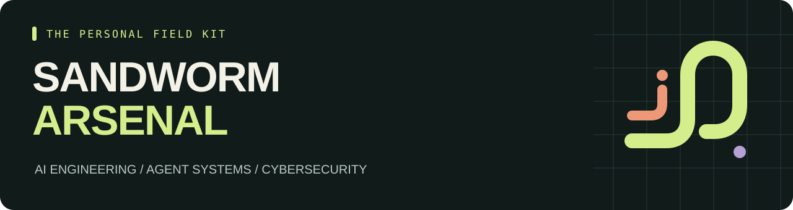

<p align="center"></p>

<p align="center"><b>57 skill entries · 19 skill collections · 3 evaluation tools</b><br>Curated by <a href="https://github.com/Sandworm-Lazarus">Sandworm-Lazarus</a> · Source review: 11 November 2026</p>

<p align="center"><a href="README.th.md">ภาษาไทย</a> · <a href="CATALOG.md">Browse the arsenal</a> · <a href="docs/starter-packs.md">Starter packs</a> · <a href="SOURCES.md">Sources &amp; licenses</a></p>

# Sandworm Arsenal

A personal collection of useful **AI and cybersecurity agent skills**, with Thai annotations, pinned source links, and practical workflows. Built for people who want to understand what a skill does before adding it to their tools.

This repository contributes the curation, original summaries, three original playbooks, and a small offline catalog CLI. Linked skills belong to their respective authors. Upstream skill code is not bundled here.

## Choose your direction

| Track | What you can explore | Start here |
| --- | --- | --- |
| AI Engineering | Model serving, quantization, fine-tuning, RAG, evaluation | [AI lab pack](docs/starter-packs.md#ai-lab) |
| Agent / Context | Memory, context compression, tool design, human review | [Agent builder pack](docs/starter-packs.md#agent-builder) |
| AI Security | Prompt injection, MCP review, model provenance, trust boundaries | [Agent defense pack](docs/starter-packs.md#agent-defense) |
| Cyber | Code review, dependency risk, detection rules, CI security | [AppSec pack](docs/starter-packs.md#appsec) |
| Reverse / DFIR | Binary analysis, protocols, memory forensics | [Reverse & DFIR pack](docs/starter-packs.md#reverse-and-dfir) |
| Engineering | Debugging, verification, Postgres, browser testing, UI design | [Full catalog](CATALOG.md#engineering) |

## A few places to begin

| Source | Why it is here |
| --- | --- |
| [Trail of Bits](https://github.com/trailofbits/skills) | Focused security review, finding verification, and rule authoring |
| [Hugging Face](https://github.com/huggingface/skills) | Local models, training, embeddings, and model workflows |
| [OWASP Secure Agent Playbook](https://github.com/OWASP/secure-agent-playbook) | Agent and MCP security review with supporting plays and templates |
| [SecSkills](https://github.com/trilwu/secskills) | Reverse engineering, DFIR, detection engineering, and extension review |
| [Context Engineering](https://github.com/muratcankoylan/Agent-Skills-for-Context-Engineering) | Context, memory, and tool interface design |
| [AI Research Skills](https://github.com/Orchestra-Research/AI-Research-SKILLs) | Serving, quantization, evaluation, and fine-tuning workflows |

These are editorial starting points, not benchmark rankings or security endorsements. See the [complete source register](SOURCES.md) for the reviewed revisions and license notes.

## Original playbooks

Three concise workflows authored for this repository. Each includes required inputs, a procedure, an output contract, and a worked example. They are Markdown guides to give an agent as task context, not an automatic installer or a tested integration with every agent client.

| Playbook | Use it when you need to… |
| --- | --- |
| [Review an agent extension](playbooks/review-agent-extension.md) | Trace permissions, outbound data, hooks, and setup behavior before adoption |
| [Review a diff with evidence](playbooks/review-diff-with-evidence.md) | Separate verified findings from open questions and attach reproducible checks |
| [Compare models fairly](playbooks/compare-models.md) | Compare quality, latency, and cost using the same tasks and explicit assumptions |

Examples are illustrative. No live security certification or model benchmark is claimed.

## Search locally

The CLI uses the Python standard library and performs no network requests.

```bash
git clone https://github.com/Sandworm-Lazarus/sandworm-arsenal.git
cd sandworm-arsenal
python3 scripts/arsenal.py search "memory"
python3 scripts/arsenal.py search "กฎ" --category "Cyber"
python3 scripts/arsenal.py check
```

On Windows, use `py -3` if `python3` is unavailable. Prefer browsing? Open [CATALOG.md](CATALOG.md). Want structured data? Use [catalog/arsenal.json](catalog/arsenal.json).

## What “reviewed” means

The initial research read **57 skill entry files and 12 supporting files**. The catalog records repository commits, entry paths, and blob identifiers so the review can be traced to a specific revision. The 22-source register includes 19 skill collections and 3 evaluation tools.

**Source review is not runtime testing.** All upstream entries currently have `runtime_tested: false`. Dependencies, remote services, and compatibility must be checked for the environment where a skill will run. Some entries route to supporting files; copying only `SKILL.md` can lose required context.

The local `check` command verifies catalog consistency, pinned-link structure, generated documentation, SVG syntax, and local file links. It does not contact upstream repositories or certify a skill's behavior. See [review methodology](docs/methodology.md).

## Contribute and reuse

Suggest a useful source or correct a stale entry through a pull request. Include a pinned revision, a task it helps with, requirements, and license evidence; see [CONTRIBUTING.md](CONTRIBUTING.md).

Original repository material is [MIT licensed](LICENSE). External projects retain their own licenses. In particular, Trail of Bits uses CC BY-SA, and some other entries have scoped or unresolved license notes. Consult [attribution and reuse](docs/attribution.md) before copying upstream material.

Independent personal curation. No affiliation with the linked organizations.
