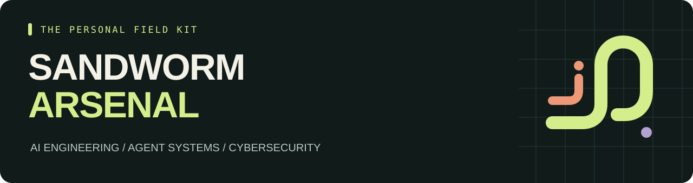

<p align="center"></p>

<p align="center"><b>160 สกิล · 29 คลังต้นทาง · 66 เครื่องมือประกอบ</b><br>คัดและเรียบเรียงโดย <a href="https://github.com/Sandworm-Lazarus">Sandworm-Lazarus</a> · ตรวจต้นทาง 11 พฤศจิกายน 2026</p>

<p align="center"><a href="README.md">English</a> · <a href="CATALOG.md">ดูสกิลทั้งหมด</a> · <a href="docs/starter-packs.md">ชุดเริ่มต้น</a> · <a href="SOURCES.md">ต้นทางและสิทธิ์ใช้งาน</a></p>

# Sandworm Arsenal

## คลังที่แยกเป็น repo เฉพาะด้าน

| Repository | Focus | Skills | Tools |
| --- | --- | ---: | ---: |
| [AI Toolbox](https://github.com/Sandworm-Lazarus/sandworm-ai-toolbox) | A directory of practical AI tools and frameworks, from personal agents and local inference to voice, documents, coding, and observability. | 0 | 48 |
| [Agent Skills](https://github.com/Sandworm-Lazarus/sandworm-agent-skills) | Focused agent workflows for context, memory, tool design, orchestration, browser use, and voice interfaces. | 13 | 18 |
| [Cyber Arsenal](https://github.com/Sandworm-Lazarus/sandworm-cyber-arsenal) | A focused security collection covering AppSec, agent and MCP security, reverse engineering, DFIR, detection, and supply-chain review. | 68 | 19 |
| [LLM Lab](https://github.com/Sandworm-Lazarus/sandworm-llm-lab) | A practical LLM engineering lab: model serving, quantization, RAG, evaluation, training, and experiment observability. | 49 | 15 |
| [Dev Playbooks](https://github.com/Sandworm-Lazarus/sandworm-dev-playbooks) | Developer workflows for debugging, cloud, frontend, coding agents, and evidence-backed reviews, with original playbooks and report templates. | 30 | 17 |

Repo นี้เป็นหน้ารวม คลังสกิลแบ่งตามงาน ส่วน AI Toolbox เป็นสารบัญเครื่องมือ เครื่องมือบางตัวอยู่ได้หลายคลัง จึงไม่ควรนำจำนวนจากทุก repo มาบวกเป็นจำนวนไม่ซ้ำ

คลังสกิล **AI และ Cybersecurity** ที่คัดไว้ใช้เรียนรู้และต่อยอด มีคำอธิบายภาษาไทย ลิงก์ระบุ commit และหมายเหตุเรื่องเครื่องมือที่ต้องใช้ เพื่อให้เลือกได้ว่าสกิลไหนตรงกับงานของเรา

ผลงานของคลังนี้คือการคัดสรร สรุปข้อมูล จัดชุดเริ่มต้น เขียน playbook 3 ชุด ทำเครื่องมือค้นหารายการแบบออฟไลน์ และพัฒนา Privacy Guard ของเรา สกิลที่ลิงก์ออกไปยังเป็นผลงานของผู้เขียนต้นทาง และไม่ได้คัดลอกโค้ดทั้งแพ็กมารวมไว้ที่นี่

## เครื่องมือของเรา: Privacy Guard

แต่ละ repo เฉพาะด้านมีเครื่องมือที่เราเขียนตามหน้าที่ของมัน ได้แก่ ตัวคำนวณต้นทุน AI, ตัวตรวจสิทธิ์ tool calls, detection lab, ตัววัดผลคำตอบที่บันทึกไว้ และตัวตรวจหลักฐาน อ่าน [ผลงานของเราและเครดิตต้นทาง](ORIGINAL_WORK.md) และ [ทะเบียนโครงการ](originals/manifest.json)

```bash
python3 scripts/check_originals.py
```

ปิดบังอีเมลและฟิลด์ JSON ที่กำหนดก่อนนำข้อมูลไปเตรียมบริบทให้ Agent หรือบันทึก log ใช้ Python 3.9+ standard library ทำงานออฟไลน์ มีขีดจำกัดขนาดและความลึกของ input และข้อความผิดพลาดที่ไม่พิมพ์ข้อมูลต้นฉบับ

```bash
python3 scripts/privacy_guard.py json --sensitive-field customer_name < examples/privacy-input.json
python3 scripts/check_privacy_fixtures.py --check-report examples/privacy-guard-results.json
python3 -m unittest discover -s tests -v
```

อ่าน [วิธีใช้และขอบเขต](docs/privacy-guard.md), [ผลตรวจข้อมูลจำลอง](examples/privacy-guard-results.json) และ [บันทึกการพัฒนา](docs/development-notes/2026-11-11-original-tools.md) เครื่องมือนี้ใช้กฎปิดบังอีเมลและฟิลด์ที่ระบุ ข้อมูลอ่อนไหวประเภทอื่นต้องกำหนดฟิลด์หรือประเมินตัวตรวจแยกเพิ่มเติม

## รอบคัดล่าสุด

เพิ่ม [เครื่องมือ 5 ตัวที่ช่วยงานจริง](docs/curation-notes/2026-11-11-mcp-typescript.md): MCP Inspector, Mastra, Vercel AI SDK, Presidio และ Bruno พร้อมโจทย์ทดลอง 3 แบบและข้อมูลจำลองสำหรับตรวจ privacy pipeline

## เครื่องมือ AI นอกเหนือจากสกิล

เพิ่ม [AI toolbox guide](docs/ai-toolbox.md) อีก 44 โครงการ ครอบคลุม Agent ส่วนตัว, local models, voice, browser automation, เอกสาร, memory, ภาพ, coding และ model operations พร้อมแนวทางทำโปรเจกต์ของตัวเอง 5 แบบ

## เลือกตามงาน

| หมวด | เหมาะกับอะไร | เริ่มจาก |
| --- | --- | --- |
| AI Engineering | รันโมเดล, quantize, fine-tune, RAG และวัดผล | [AI lab](docs/starter-packs.md#ai-lab) |
| Agent / Context | ออกแบบ memory, context, tools และจุดให้คนตัดสินใจ | [Agent builder](docs/starter-packs.md#agent-builder) |
| AI Security | ตรวจ prompt injection, MCP และสิทธิ์ของ Agent | [Agent defense](docs/starter-packs.md#agent-defense) |
| Cyber | รีวิวโค้ด, dependency, CI และกฎตรวจจับ | [AppSec](docs/starter-packs.md#appsec) |
| Reverse / DFIR | วิเคราะห์ binary, protocol และ memory image | [Reverse & DFIR](docs/starter-packs.md#reverse-and-dfir) |
| Engineering | Debug, Postgres, ทดสอบหน้าเว็บ และออกแบบ UI | [รายการทั้งหมด](CATALOG.md#engineering) |

## คู่มือที่เขียนขึ้นสำหรับคลังนี้

| Playbook | ผลลัพธ์ที่ต้องการ |
| --- | --- |
| [ตรวจ Agent extension ก่อนใช้](playbooks/review-agent-extension.md) | รายงานสิทธิ์ การส่งข้อมูล hooks และประเด็นที่ยังพิสูจน์ไม่ได้ |
| [รีวิว diff พร้อมหลักฐาน](playbooks/review-diff-with-evidence.md) | Finding ที่อ้างไฟล์ เงื่อนไขเกิดปัญหา และวิธีตรวจซ้ำได้ |
| [เปรียบเทียบโมเดลอย่างเป็นธรรม](playbooks/compare-models.md) | ตารางคุณภาพ ความเร็ว ต้นทุน และข้อจำกัดภายใต้เงื่อนไขเดียวกัน |

เปิดไฟล์แล้วส่งให้ Agent อ่านเป็นบริบทของงานได้ แต่คู่มือเหล่านี้ยังไม่ใช่ตัวติดตั้งสกิลอัตโนมัติ ตัวอย่างเป็นสถานการณ์จำลอง ไม่ใช่ผล benchmark หรือการรับรองความปลอดภัย

## ค้นหารายการบนเครื่อง

ใช้ Python standard library ไม่ติดตั้ง dependency และไม่ส่งข้อมูลออกจากเครื่อง

```bash
git clone https://github.com/Sandworm-Lazarus/sandworm-arsenal.git
cd sandworm-arsenal
python3 scripts/arsenal.py search "RAG"
python3 scripts/arsenal.py search "สิทธิ์" --category "AI Security"
python3 scripts/arsenal.py check
```

Windows ใช้ `py -3` แทน `python3` ได้ หรือเปิด [CATALOG.md](CATALOG.md) เพื่ออ่านบน GitHub โดยตรง

## ใช้งานให้ตรงโจทย์

- [12 ชุดเริ่มต้น](docs/starter-packs.md): AI lab, RAG, MLOps, Agent, AppSec, Cloud, auth, CI, fuzzing และเกมเซิร์ฟเวอร์
- [ตารางเลือกตามงาน](docs/decision-guide.md): เริ่มตรงไหน ใช้ skill หรือเครื่องมืออะไร และควรได้หลักฐานแบบใด
- [เครื่องมือประกอบ 66 ตัว](TOOLS.md): ประเมิน AI, ตรวจโค้ด, secrets, SBOM, container และ CI
- [แม่แบบรายงาน 5 แบบ](templates/README.md): finding, threat model, model evaluation, extension review และ detection rule
- [ข้อควรรู้ของต้นทาง](docs/watchlist.md): การย้าย repo, license และเงื่อนไขเฉพาะแพลตฟอร์ม

## ตรวจถึงระดับไหน

| ระดับ | จำนวน | ขอบเขต |
| --- | ---: | --- |
| Entry-reviewed | 57 | อ่าน entry และไฟล์ประกอบบางส่วนในรอบรีเสิร์ชแรก |
| Entry-overview | 103 | ตรวจตัวตนไฟล์ frontmatter และเนื้อหาช่วงต้น ยังไม่ได้อ่านครบทั้ง bundle |
| Companion tools | 66 | ตรวจภาพรวม README/source และหลักฐาน license |

ยังไม่ได้รันสกิลหรือเครื่องมือต้นทางจริง ดู [รายงาน coverage](docs/review-status.md) และ [วิธีคัดและตรวจ](docs/methodology.md) ได้ ทุก entry มีลิงก์ที่ตรึง commit และบันทึกระดับที่ตรวจไว้

ตั้ง workflow ให้ตรวจเมื่อ push หรือเปิด pull request แล้ว ดูสถานะการรันจริงได้ใน Actions การตรวจ local ครอบคลุม catalog, การปฏิเสธข้อมูลผิดรูป, การสร้างคลังย่อยแบบ deterministic และ Privacy Guard ของเรา รายงาน fixture ระบุ SHA-256 ของโค้ดและชุดข้อมูล คำสั่งเหล่านี้ไม่รันแพ็กเกจต้นทางที่ลิงก์ไว้

```bash
python3 scripts/arsenal.py search "MCP" --review entry-reviewed
python3 scripts/arsenal.py search "" --repo cloudflare/skills --json
python3 scripts/arsenal.py show 1
python3 scripts/arsenal.py stats
```

## เครดิตและการต่อยอด

งานเขียนและโค้ดที่สร้างขึ้นสำหรับ repository นี้ใช้ [MIT License](LICENSE) ส่วนผลงานต้นทางใช้ license ของเจ้าของแต่ละแห่ง เช่น Trail of Bits ใช้ CC BY-SA และมีบางแพ็กที่ขอบเขตสิทธิ์ยังต้องตรวจเพิ่ม ดู [SOURCES.md](SOURCES.md) และ [แนวทางให้เครดิต](docs/attribution.md) ก่อนนำเนื้อหาต้นทางมาดัดแปลง

อยากเพิ่มสกิลหรือแก้ข้อมูล ส่ง pull request พร้อมต้นทางและหลักฐานตาม [แนวทางร่วมพัฒนา](CONTRIBUTING.md) ได้

คลังส่วนตัวอิสระ ไม่ได้สังกัดองค์กรที่อ้างถึง
